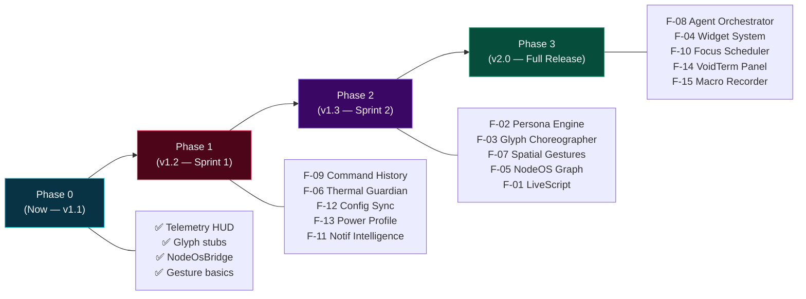

# VoidLauncher — Advanced Features Blueprint
> **Version**: 2.0 Design Specification  
> **Baseline**: v1.1.0 (Sovereign Cockpit) · Nothing Phone (2a) · Android 16 · Dimensity 7200 Pro  
> **Authored**: 2026-11-01  
> **Scope**: Architecture-grade feature design for the next evolution of VoidLauncher

---

## Blueprint Index

| ID | Feature | Tier | Effort |
|----|---------|------|--------|
| F-01 | **LiveScript Engine** — Inline Kotlin/Shell scripting from Omni-bar | 🔴 Core | L |
| F-02 | **Smart Persona Engine** — Multi-identity profiles beyond VOID/MAIN | 🔴 Core | M |
| F-03 | **Glyph Choreographer** — Full Nothing GDK integration with patterns | 🔴 Core | M |
| F-04 | **VoidWidget System** — Plugin widget cards on cockpit home | 🟠 Advanced | XL |
| F-05 | **NodeOS Live Graph** — Real-time AST topology visualization | 🟠 Advanced | L |
| F-06 | **Thermal Throttle Guardian** — Active workload suppressor | 🟠 Advanced | M |
| F-07 | **Spatial Gesture Grammar** — Multi-touch + directional compound gestures | 🟠 Advanced | M |
| F-08 | **Agent Task Orchestrator** — Dispatch & track agent workflows from launcher | 🔴 Core | XL |
| F-09 | **OmniScript History & Snippets** — Persistent command palette with search | 🟡 Quality | S |
| F-10 | **Focus Mode Scheduler** — Time-boxed context switching automation | 🟡 Quality | M |
| F-11 | **Notification Intelligence Layer** — Priority scoring & silent routing | 🟡 Quality | M |
| F-12 | **Config Sync over Void store** — FileObserver hot-reload + SAF import/export | 🟠 Advanced | M |
| F-13 | **Adaptive Power Profile** — Dynamic UI density based on battery/thermal state | 🟡 Quality | S |
| F-14 | **VoidTerm Embedded Panel** — Native terminal pane within launcher | 🔴 Core | XL |
| F-15 | **Macro Recorder** — Record & replay interaction sequences | 🟡 Quality | L |

---

## System Architecture — v2.0 Module Map

```
com.polymath.voidlauncher/ (v2.0)
├── VoidLauncherActivity.kt             # Orchestrator (unchanged interface)
├── VoidSettingsActivity.kt             # Extended settings with Live Preview
│
├── core/
│   ├── AppIndexer.kt                   # EXISTING — extended: usage ranking
│   ├── BareIntegerRouter.kt            # EXISTING — extended: macro hooks
│   ├── ConfigManager.kt               # EXISTING — extended: config diff engine
│   ├── FileManager.kt                  # EXISTING
│   ├── NodeOsBridge.kt                # EXISTING — extended: live SQLite polling
│   ├── NothingGlyphManager.kt          # EXISTING → F-03: Full GDK patterns
│   ├── TelemetryMonitor.kt             # EXISTING — extended: swap + CPU cores
│   ├── VoidShellPort.kt              # Void-owned shell (replaces the old dispatcher)
│   │
│   ├── [NEW] LiveScriptEngine.kt       # F-01: Sandboxed Kotlin + sh eval engine
│   ├── [NEW] PersonaManager.kt         # F-02: Multi-identity profile vault
│   ├── [NEW] GlyphChoreographer.kt     # F-03: Pattern library + sequencer
│   ├── [NEW] WidgetRegistry.kt         # F-04: Card plugin registry + lifecycle
│   ├── [NEW] AstGraphRenderer.kt       # F-05: SQLite → graph data model
│   ├── [NEW] ThermalGuardian.kt        # F-06: Thermal → workload suppressor
│   ├── [NEW] CompoundGestureEngine.kt  # F-07: Multi-touch gesture grammar
│   ├── [NEW] AgentOrchestrator.kt      # F-08: workflow.json task dispatch loop
│   ├── [NEW] CommandPalette.kt         # F-09: Command history + snippet vault
│   ├── [NEW] FocusScheduler.kt         # F-10: Time-boxed context scheduler
│   ├── [NEW] NotifIntelligence.kt      # F-11: Priority scoring + routing rules
│   ├── [NEW] ConfigSyncService.kt      # F-12: Void store FileObserver + SAF import/export
│   ├── [NEW] PowerProfileAdaptor.kt    # F-13: Dynamic UI density engine
│   ├── [NEW] VoidTermPanel.kt          # F-14: Embedded pseudo-terminal pane
│   └── [NEW] MacroRecorder.kt          # F-15: Interaction sequence recorder
│
├── model/
│   ├── AppEntry.kt                     # EXISTING
│   ├── FileItem.kt                     # EXISTING
│   ├── IntentStatus.kt                 # EXISTING — extended: agent task fields
│   ├── LauncherConfig.kt               # EXISTING — extended: all new config keys
│   ├── TelemetrySnapshot.kt            # EXISTING — extended: swap + CPU
│   ├── [NEW] PersonaProfile.kt         # F-02: Identity profile data class
│   ├── [NEW] WidgetDescriptor.kt       # F-04: Plugin widget metadata
│   ├── [NEW] AgentTask.kt              # F-08: Dispatched agent task model
│   ├── [NEW] CommandEntry.kt           # F-09: History/snippet record
│   ├── [NEW] FocusBlock.kt             # F-10: Scheduled focus window model
│   └── [NEW] GlyphPattern.kt           # F-03: Glyph LED animation descriptor
│
└── ui/
    ├── AlphabetScrubberView.kt         # EXISTING
    ├── AppFilterAdapter.kt             # EXISTING
    ├── DrawerAppAdapter.kt             # EXISTING
    ├── FileBrowserAdapter.kt           # EXISTING
    ├── NotificationAdapter.kt          # EXISTING
    ├── [NEW] WidgetCardView.kt         # F-04: Pluggable card surface view
    ├── [NEW] AstGraphView.kt           # F-05: Canvas-drawn AST topology
    ├── [NEW] CommandPaletteView.kt     # F-09: Floating command history overlay
    ├── [NEW] VoidTermView.kt           # F-14: Embedded terminal view surface
    └── [NEW] MacroPlaybackOverlay.kt   # F-15: Macro replay indicator overlay
```

---

## Feature Specifications

---

### F-01 · LiveScript Engine
> **Tagline**: Type Kotlin expressions or shell pipelines directly in the omni-bar, see output inline.

**Problem**: The current `:sh <cmd>` prefix ran blindly out-of-process with no inline output. Power users want to evaluate expressions without leaving the launcher.

**Design**:
- New `:eval <expr>` omni-bar command routes to `LiveScriptEngine.kt`
- Kotlin expressions use `javax.script.ScriptEngineManager` (if available) or a lightweight expression evaluator
- Shell commands pipe output back via `VoidShellRunner` output capture
- Output renders inline in `tvTerminalOutput` with monospaced formatting, scrollable up to 200 lines

**Scope**: `LiveScriptEngine.kt` + `VoidShellRunner`

```kotlin
// Usage:
// :eval 1024 * 1024        → 1048576
// :eval System.nanoTime()  → 439823947234
// :eval :sh ls ~/Projects  → [captured output]
```

**Config Keys**:
```json
"livescript_enabled": true,
"livescript_output_max_lines": 200,
"livescript_history_limit": 100
```

---

### F-02 · Smart Persona Engine
> **Tagline**: Beyond VOID/MAIN — unlimited named identity profiles with distinct color palettes, dock slots, and Void workspace bindings.

**Problem**: `NodeOsBridge` supports only binary `VOID` / `MAIN` switching. Real workflows demand more contexts: `AGENT`, `CLIENT`, `RESEARCH`, `FOCUS`.

**Design**:
- `PersonaProfile.kt` — data class with: `id`, `label`, `color_palette`, `dock_slots`, `workspace_path`, `glyph_color`, `nodeos_db_path`
- `PersonaManager.kt` — loads profiles from `~/.voidlauncher/personas/` directory, keyed by filename
- `VoidLauncherActivity` delegates identity badge tap to `PersonaManager.cyclePersona()` (cycles through all loaded profiles)
- Long-press on identity badge opens profile selector dialog
- Active persona is persisted in SharedPreferences and re-applied on each `onResume()`

**Config Extension**:
```json
"personas": [
  { "id": "void",     "label": "[VOID]",   "accent": "#E11D48", "workspace": "~/Projects" },
  { "id": "agent",    "label": "[AGENT]",  "accent": "#8B5CF6", "workspace": "~/Projects" },
  { "id": "client",  "label": "[CLIENT]", "accent": "#F59E0B", "workspace": "~/Projects/PodPitch" }
]
```

---

### F-03 · Glyph Choreographer
> **Tagline**: Fully programmatic Nothing Phone (2a) Glyph LED patterns — not just on/off pulses.

**Problem**: `NothingGlyphManager` only logs stubs. The Nothing GDK allows rich animations: channel selection, brightness curves, period control.

**Design**:
- `GlyphChoreographer.kt` wraps the Nothing Glyph Developer Kit `GlyphManager` and `GlyphFrame.Builder`
- `GlyphPattern.kt` — descriptors: `name`, `channels: List<Int>`, `period_ms`, `cycles`, `brightness_curve`
- Built-in patterns library: `THERMAL_WARNING`, `TASK_SUCCESS`, `TASK_FAIL`, `FOCUS_MODE_ON`, `AGENT_RUNNING`
- Custom patterns definable in `~/.voidlauncher/glyph_patterns.json`
- `TelemetryMonitor` thermal trigger → `GlyphChoreographer.play("THERMAL_WARNING")`
- `AgentOrchestrator` task completion → `GlyphChoreographer.play("TASK_SUCCESS")`

**Dependencies**: `com.nothing.ketchum:glyph:1.x` (Nothing GDK)

```kotlin
glyphChoreographer.play(GlyphPattern(
    name = "AGENT_RUNNING",
    channels = listOf(1, 2, 3),
    periodMs = 400,
    cycles = -1,  // loop until cancelled
    brightnessCurve = BrightnessCurve.SINE
))
```

---

### F-04 · VoidWidget System
> **Tagline**: Pluggable card slots on the cockpit homescreen — weather, stock tickers, agent dashboards, SSH pings.

**Problem**: The cockpit is fixed — telemetry, intent, notifications. Users need to embed custom data panels without modifying source.

**Design**:
- `WidgetDescriptor.kt` — `id`, `title`, `type` (SCRIPT | HTTP | INTENT), `source`, `refresh_ms`, `height_dp`
- `WidgetRegistry.kt` — scans `~/.voidlauncher/widgets/` for `*.widget.json` descriptors, instantiates `WidgetCardView` per entry
- `WidgetCardView.kt` — extends `CardView`, renders header + content TextView, taps through to configurable action
- Widget types:
  - `SCRIPT` — runs `:sh <script>` via `VoidShell`, captures stdout into card
  - `HTTP` — calls a local endpoint (e.g., NodeOS `/api/status`) using `OkHttp`
  - `INTENT` — broadcasts an Android intent and displays extra data from a sticky broadcast response
- Widget data flows via `Flow<String>` with configurable `refresh_ms`
- Cards inserted dynamically above the dock in `rootLayout`

```json
// ~/.voidlauncher/widgets/nodeos_stats.widget.json
{
  "id": "nodeos_stats",
  "title": "NodeOS Stats",
  "type": "SCRIPT",
  "source": "nodeos -c stats --json | python3 -c \"import json,sys; d=json.load(sys.stdin); print(f\\\"Nodes: {d['total']} | Files: {d['files']}\\\")\"",
  "refresh_ms": 5000,
  "height_dp": 48
}
```

---

### F-05 · NodeOS Live Graph
> **Tagline**: Miniature canvas-drawn AST topology — see your codebase graph live.

**Problem**: `NodeOsBridge` reports only a rough heuristic node count from SQLite file size. The actual graph topology in `agy_nodeos.db` is rich — nodes, edges, node types.

**Design**:
- `AstGraphRenderer.kt` — queries `agy_nodeos.db` directly using Android's `android.database.sqlite.SQLiteDatabase.openDatabase(path, null, OPEN_READONLY)`
  ```sql
  SELECT node_type, COUNT(*) FROM nodes GROUP BY node_type LIMIT 20;
  SELECT src_id, dst_id, rel_type FROM edges LIMIT 100;
  ```
- `AstGraphView.kt` — `View` subclass with `Canvas`-drawn force-directed mini-graph (50–100 node cap for perf)
- Tapping a node type in the graph dispatches `:sh nodeos -c search "<type>"` and renders results in `tvTerminalOutput`
- Toggled via `:graph` omni-bar command or swipe gesture action `OPEN_GRAPH`
- Collapsed in Minimal mode automatically

**Perf Guards**: DB open is IO-dispatched via `Dispatchers.IO`, canvas draw capped at 30fps on `choreographer.postFrameCallback`

---

### F-06 · Thermal Throttle Guardian
> **Tagline**: When the Nothing Phone (2a) gets hot, the launcher actively cancels background Void tasks by handle.

**Problem**: `TelemetryMonitor` detects `>39°C` and pulses the Glyph LED, but takes no action on running processes.

**Design**:
- `ThermalGuardian.kt` — subscribes to `TelemetryMonitor.monitorTelemetry()` flow
- When `temp > thermalLimitCelsius`:
  1. Dispatches `:sh pkill -f "nodeos.*daemon" && pkill -f "python.*agent"` (configurable kill list)
  2. Sets `AgentOrchestrator` to `SUSPENDED` state
  3. Pulses Glyph THERMAL_WARNING pattern
  4. Shows sticky banner: `"⚠ THERMAL THROTTLE ACTIVE [42.1°C] — Workloads suspended"`
- When `temp < (thermalLimitCelsius - 2.0)` (hysteresis band), clears throttle state and resumes

**Config Keys**:
```json
"thermal_guardian_enabled": true,
"thermal_kill_commands": ["pkill -f nodeos.*daemon", "pkill -f python.*ml"],
"thermal_hysteresis_celsius": 2.0
```

---

### F-07 · Spatial Gesture Grammar
> **Tagline**: Multi-touch compound gestures — pinch, two-finger swipe, edge swipe zones.

**Problem**: `VoidGestureDetector` handles only single-touch flings, double-tap, and long-press. The Dimensity 7200 Pro and AMOLED panel support much richer input.

**Design**:
- `CompoundGestureEngine.kt` replaces `VoidGestureDetector` (backwards-compatible wrapper)
- New gesture primitives:
  - `TWO_FINGER_SWIPE_UP/DOWN` → configurable action (e.g., launch `pmc hud`)
  - `PINCH_IN` → enter Minimal mode
  - `PINCH_OUT` → expand to full Cockpit mode
  - `LEFT_EDGE_SWIPE` → open Files panel (edge zone: left 12dp)
  - `RIGHT_EDGE_SWIPE` → open App Drawer (edge zone: right 12dp)
  - `BOTTOM_EDGE_SWIPE_UP` → summon Omni-bar (focus + keyboard)
- Uses `ScaleGestureDetector` + `GestureDetectorCompat` composed in `CompoundGestureEngine`
- All new gestures are mapped in config JSON for user remapping

**Config Extension**:
```json
"gesture_two_finger_up":       "OPEN_HUD",
"gesture_pinch_in":            "TOGGLE_MINIMAL",
"gesture_pinch_out":           "COCKPIT_MODE",
"gesture_left_edge_swipe":     "OPEN_FILES",
"gesture_right_edge_swipe":    "OPEN_DRAWER",
"gesture_bottom_edge_swipe":   "FOCUS_OMNI"
```

---

### F-08 · Agent Task Orchestrator
> **Tagline**: The launcher becomes a cockpit for dispatching, tracking, and completing AI agent workflows — without leaving the homescreen.

**Problem**: Agent tasks live in `workflow.json` and `NodeOsBridge` polls it, but the launcher has no dispatch surface, no task queue, and no completion hooks.

**Design**:
- `AgentOrchestrator.kt` — reads/writes `workflow.json` tasks with status: `pending → running → completed/failed`
- `AgentTask.kt` — `id`, `title`, `command`, `status`, `started_at`, `completed_at`, `output_preview`
- UI: new `taskQueueCard` below `intentCard` — shows active task list with status dots and progress
- Omni-bar commands:
  - `:task <name> <cmd>` — injects new task entry into `workflow.json` and dispatches via VoidShell
  - `:tasks` — opens the task queue overlay card
  - `:kill <id>` — cancels the Void task by handle and marks task `cancelled`
- Task output preview captured via `VoidShell` output (stderr+stdout, first 5 lines)
- Task completion → Glyph pulse `TASK_SUCCESS` / `TASK_FAIL`
- Task queue persists across launcher sessions (SQLite `void_tasks.db` in app sandbox)

```
COCKPIT HOMESCREEN (v2.0)
┌─────────────────────────────────┐
│ ● 03:34 · 42% [37.2°C] · 4.2G  │  ← Telemetry bar
├─────────────────────────────────┤
│ NodeOS Card  ─  AST: 847 nodes  │
├─────────────────────────────────┤
│ Intent Card  ─  [running] …     │
├─────────────────────────────────┤
│ Task Queue   ─  2 active tasks  │  ← NEW F-08
│  ● build PodPitch APK           │
│  ○ run ml_train.py              │
├─────────────────────────────────┤
│ Notifications (3)               │
├─────────────────────────────────┤
│ Widget Cards (configurable)     │  ← NEW F-04
├─────────────────────────────────┤
│ [1] TERMINAL  [2] FILES …       │  ← Dock
└─────────────────────────────────┘
```

---

### F-09 · OmniScript History & Snippets
> **Tagline**: Persistent command palette — every `:cmd` you've typed is searchable and replayable.

**Problem**: There is no history. Every shell command must be re-typed from scratch.

**Design**:
- `CommandPalette.kt` — `Room` database (`CommandEntry`: `id`, `text`, `timestamp`, `use_count`, `tag`)
- `CommandPaletteView.kt` — floating `RecyclerView` overlay triggered by `:` prefix in omni-bar
- Navigation: hardware volume-up/down keys scroll history list when omni-bar is focused (keyboard-nav override)
- Commands prefixed with `##` are saved as named snippets: `:sh pmc status ## hud-check`
- `:snippets` command opens full snippet manager with search

**Config Keys**:
```json
"command_history_enabled": true,
"command_history_limit": 500,
"command_palette_fuzzy": true
```

---

### F-10 · Focus Mode Scheduler
> **Tagline**: Time-boxed identity + context switching — automatically reconfigure the launcher at scheduled times.

**Problem**: Manual identity switching is fine for intentional switches, but not for scheduled workflow transitions (e.g., "8am = WORK, 6pm = PERSONAL").

**Design**:
- `FocusScheduler.kt` — `AlarmManager`-backed scheduler
- `FocusBlock.kt` — `id`, `cron_expression`, `persona_id`, `dock_slots_override`, `glyph_pattern`, `notification_filter`
- Defined in `~/.voidlauncher/focus_schedule.json`
- On trigger:
  1. `PersonaManager.activatePersona(persona_id)`
  2. Override dock slots if specified
  3. Trigger Glyph pattern `FOCUS_MODE_ON`
  4. Show focus banner: `"[FOCUS] WORK mode active until 18:00"`
- `:focus` omni-bar command shows current schedule and allows manual override

```json
// ~/.voidlauncher/focus_schedule.json
[
  { "id": "work",    "cron": "0 8 * * 1-5",  "persona": "void",   "glyph_pattern": "FOCUS_MODE_ON" },
  { "id": "evening", "cron": "0 18 * * *",    "persona": "main",   "glyph_pattern": "NONE" }
]
```

---

### F-11 · Notification Intelligence Layer
> **Tagline**: AI-free, rule-based priority scoring — only critical signals reach the cockpit.

**Problem**: All notifications appear equally. A Termux task completion is more important than a social media badge.

**Design**:
- `NotifIntelligence.kt` — rule engine in `VoidNotificationListenerService`
- `Priority scoring` algorithm:
  - Package whitelist (multiplier ×3): Termux, Nothing Health, Phone, Calendar
  - Package blacklist (multiplier ×0, silently dropped)
  - Keyword match (multiplier ×2): "error", "failed", "agent", "completed", "thermal"
  - Ongoing notifications: configurable (currently filtered on/off toggle → now score-filtered)
  - Staleness decay: priority decreases by 0.1/min after arrival
- Sorted by score descending in `rvNotifications`
- New badge: dot color reflects top-priority notification level (`safe`, `warning`, `critical`)

**Config Extension**:
```json
"notif_whitelist_packages": ["com.termux", "com.android.phone"],
"notif_blacklist_packages": ["com.instagram.android"],
"notif_priority_keywords": ["error", "failed", "completed", "agent"],
"notif_max_score": 10.0
```

---

### F-12 · Config Sync over Termux Bridge
> **Tagline**: When a Termux daemon mutates `config.json`, the launcher instantly hot-reloads without a screen touch.

**Problem**: `ConfigManager` polls on `onResume()` — reactive only to user app-switching. Running agents that update config are invisible until the user returns to the homescreen.

**Design**:
- `ConfigSyncService.kt` — a `BroadcastReceiver` registered for a custom action: `com.polymath.voidlauncher.CONFIG_CHANGED`
- Any Termux script can fire: `am broadcast -a com.polymath.voidlauncher.CONFIG_CHANGED`
- Receiver triggers `ConfigManager.loadConfig()` → `applyConfig()` on main thread via `Handler(Looper.getMainLooper())`
- Also supports `FileObserver` on the config directory for zero-coordination hot-reload

---

### F-13 · Adaptive Power Profile
> **Tagline**: The UI actively reduces visual complexity as battery/thermal pressure rises.

**Problem**: A fully loaded cockpit with running widget flows is expensive when the battery is at 12% and temp is at 40°C.

**Design**:
- `PowerProfileAdaptor.kt` — subscribes to `TelemetryMonitor`, computes a `PowerLevel`: `PERFORMANCE | BALANCED | ECO | CRITICAL`
- Per level, automatically adjusts:
  - `telemetry_poll_ms`: ECO → 5000ms, CRITICAL → 10000ms
  - Widget refresh rates: ECO → halved, CRITICAL → paused
  - Glyph pulses: CRITICAL → disabled (save battery)
  - Card count: CRITICAL → hides widgets + notifications, shows only dock + omni
- Power profile badge shown in telemetry bar: `[ECO]` / `[CRITICAL]`

| PowerLevel | Battery | Temp | Behavior |
|---|---|---|---|
| PERFORMANCE | >60% | <36°C | Full feature set, 1s poll |
| BALANCED | 30–60% | <39°C | Normal, 1.5s poll |
| ECO | 15–30% | any | Reduced refreshes, 5s poll |
| CRITICAL | <15% or >39°C | — | Minimal UI, 10s poll, no widgets |

---

### F-14 · VoidTerm Embedded Panel
> **Tagline**: A real terminal pane rendered inside the launcher — no app switching needed.

**Problem**: Every terminal interaction requires switching to Termux, losing cockpit context.

**Design**:
- `VoidTermView.kt` — `SurfaceView`-based embedded terminal
- Uses `Termux:Tasker` plugin protocol OR a native PTY allocation via reflection-safe `ProcessBuilder` + `pty.openpty()` equivalent in Kotlin using `Os.openpty()` (Android API 21+)
- Renders 24-col × 8-row monospace output (compact cockpit-optimized dimensions)
- Accessible via `:term` or bottom-swipe-up gesture zone
- Input via floating omni-bar repurposed in terminal mode (`:term` prefix = terminal input passthrough)
- `VoidTermPanel.kt` manages the session lifecycle: spawn → output pipe → resize on IME insets

> [!WARNING]
> PTY allocation on Android without root is constrained. `Os.openpty()` works in Termux's own process space. VoidTerm v1 may use `termux-open-url termux://run` deep link + stdout broadcast as a safe fallback.

---

### F-15 · Macro Recorder
> **Tagline**: Record a sequence of launcher interactions and replay them with one integer key.

**Problem**: Repetitive launch sequences (open Termux → run pmc status → open Files → cd Projects) require multiple steps.

**Design**:
- `MacroRecorder.kt` — wraps `BareIntegerRouter` and `TermuxIpcDispatcher` with event capture
- `:record <name>` starts recording to `MacroEntry` list
- `:stop` ends recording and saves to `~/.voidlauncher/macros/<name>.json`
- `:play <name>` or bare integer `[6]`–`[9]` executes saved macros (configurable slots beyond default 1–5)
- `MacroPlaybackOverlay.kt` — non-blocking progress banner during playback

---

## Dependency Map — New vs Existing

```mermaid
flowchart TD
    VLA["VoidLauncherActivity"]

    VLA --> CM["ConfigManager (existing)"]
    VLA --> TM["TelemetryMonitor (existing)"]
    VLA --> NOB["NodeOsBridge (existing)"]
    VLA --> TID["TermuxIpcDispatcher (existing)"]

    VLA --> LSE["LiveScriptEngine (F-01)"]
    VLA --> PM["PersonaManager (F-02)"]
    VLA --> GC["GlyphChoreographer (F-03)"]
    VLA --> WR["WidgetRegistry (F-04)"]
    VLA --> AGR["AstGraphRenderer (F-05)"]
    VLA --> TG["ThermalGuardian (F-06)"]
    VLA --> CGE["CompoundGestureEngine (F-07)"]
    VLA --> AO["AgentOrchestrator (F-08)"]
    VLA --> CP["CommandPalette (F-09)"]
    VLA --> FS["FocusScheduler (F-10)"]
    VLA --> NI["NotifIntelligence (F-11)"]
    VLA --> CS["ConfigSyncService (F-12)"]
    VLA --> PPA["PowerProfileAdaptor (F-13)"]
    VLA --> VTP["VoidTermPanel (F-14)"]
    VLA --> MR["MacroRecorder (F-15)"]

    TM --> TG
    TM --> PPA
    GC --> TG
    GC --> AO
    NOB --> AGR
    TID --> LSE
    TID --> AO
    PM --> FS
    CP --> MR
```



---

## Implementation Priority Roadmap



---

## Config Schema Additions (v2.0)

All new keys are additive — backward-compatible with v1.1 defaults.

```json
{
  "_schema_version": "2.0",

  "personas": [],
  "active_persona": "void",

  "glyph_patterns_path": "~/.voidlauncher/glyph_patterns.json",
  "glyph_custom_patterns": [],

  "widgets_enabled": true,
  "widgets_directory": "~/.voidlauncher/widgets/",

  "ast_graph_enabled": false,
  "ast_graph_node_cap": 80,

  "thermal_guardian_enabled": true,
  "thermal_kill_commands": [],
  "thermal_hysteresis_celsius": 2.0,

  "compound_gestures_enabled": true,
  "gesture_two_finger_up": "OPEN_HUD",
  "gesture_pinch_in": "TOGGLE_MINIMAL",
  "gesture_pinch_out": "COCKPIT_MODE",
  "gesture_left_edge_swipe": "OPEN_FILES",
  "gesture_right_edge_swipe": "OPEN_DRAWER",
  "gesture_bottom_edge_swipe": "FOCUS_OMNI",

  "agent_orchestrator_enabled": true,
  "agent_task_db_path": "void_tasks.db",

  "command_history_enabled": true,
  "command_history_limit": 500,

  "focus_schedule_path": "~/.voidlauncher/focus_schedule.json",

  "notif_whitelist_packages": [],
  "notif_blacklist_packages": [],
  "notif_priority_keywords": ["error","failed","agent","completed"],

  "power_profile_adaptive": true,

  "voidterm_enabled": false,
  "voidterm_rows": 8,
  "voidterm_cols": 48,

  "macros_directory": "~/.voidlauncher/macros/",
  "macro_slots": { "6": null, "7": null, "8": null, "9": null }
}
```

---

## New Gradle Dependencies

```groovy
// build.gradle (app module) — additions for v2.0
dependencies {
    // Room for CommandPalette + AgentOrchestrator persistence
    implementation "androidx.room:room-runtime:2.6.1"
    implementation "androidx.room:room-ktx:2.6.1"
    kapt "androidx.room:room-compiler:2.6.1"

    // OkHttp for WidgetRegistry HTTP widgets
    implementation "com.squareup.okhttp3:okhttp:4.12.0"

    // Nothing Glyph GDK (F-03) — Nothing Developer Program
    implementation "com.nothing.ketchum:glyph:1.0.0"

    // WorkManager for FocusScheduler alarm reliability
    implementation "androidx.work:work-runtime-ktx:2.9.0"
}
```

---

## Key Architecture Invariants (Non-Negotiable)

> [!IMPORTANT]
> All new features MUST respect these constraints inherited from the v1.1 architecture:

1. **Zero UI jitter on `onResume()`** — `ConfigManager.loadConfig()` must complete in `<10ms` on the main thread. Any IO goes to `Dispatchers.IO` first.
2. **Thermal budget** — No new feature adds background coroutine loops without wiring into `PowerProfileAdaptor` to be paused in CRITICAL mode.
3. **Zero hardcoded `/bin` or `/usr/bin` paths** — All Termux paths go through `TermuxIpcDispatcher` with `$PREFIX/bin/bash` resolution.
4. **Config-gate every feature** — Every F-XX feature has a boolean config key that defaults to `false` until the user explicitly enables it. Nothing should change the default cockpit experience.
5. **SharedPreferences isolation** — `PersonaManager`, `MacroRecorder`, `FocusScheduler` each use their own named preference files — never the global `void_launcher_prefs`.
6. **Android process reflection safety** — `VoidTermPanel` MUST NOT call `proc.pid()` directly. Use `proc.javaClass.getDeclaredField("pid")`.
7. **Bionic libc compat** — `LiveScriptEngine` may not use `javax.script` if unavailable. Fallback to `:sh` dispatch always.
